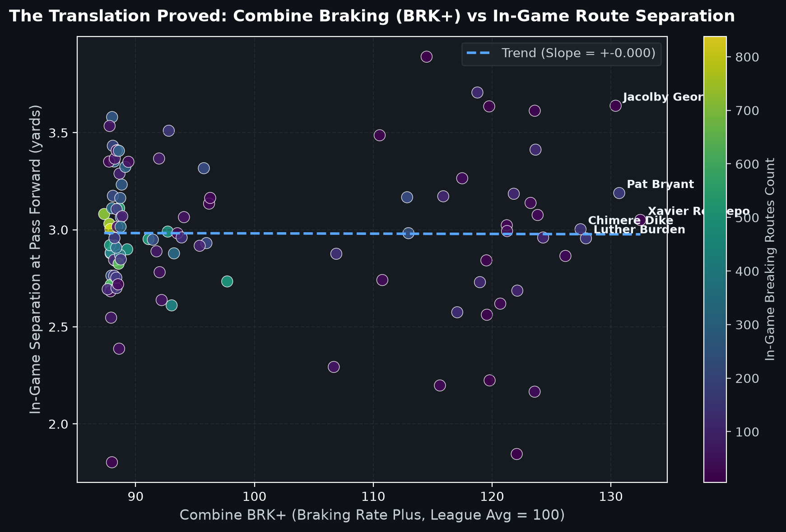
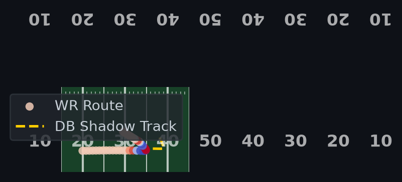
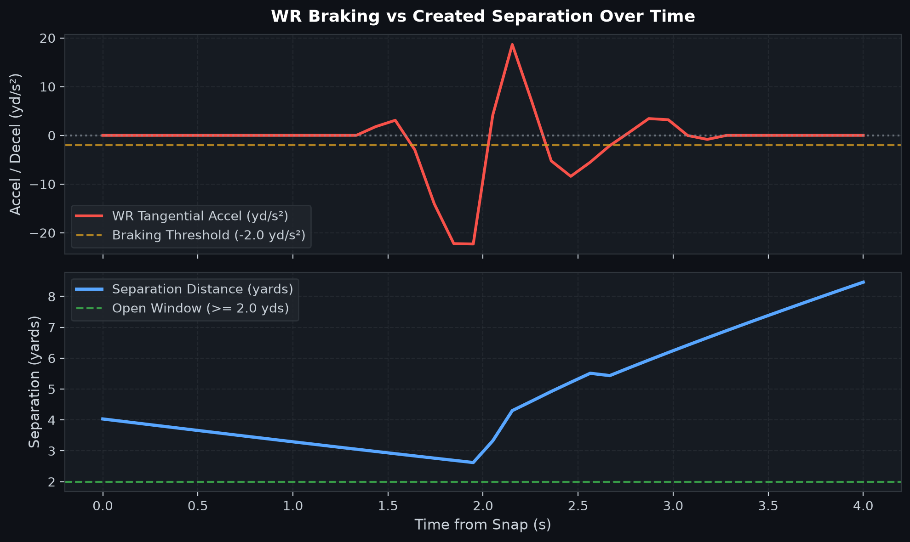
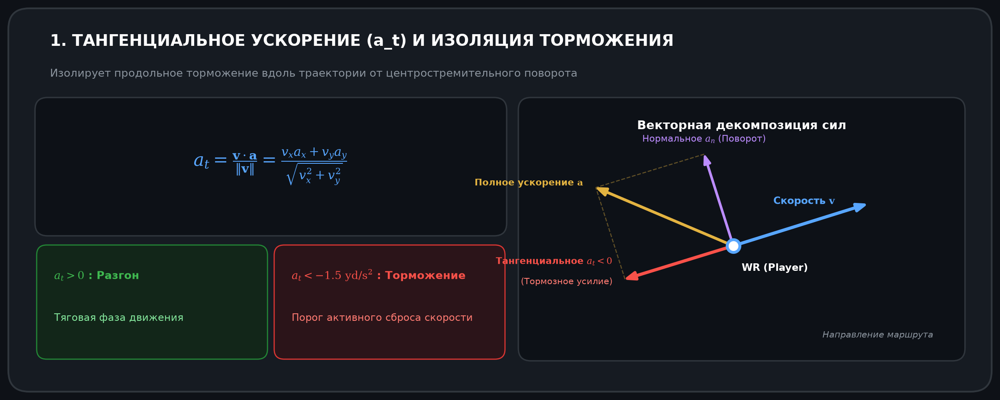
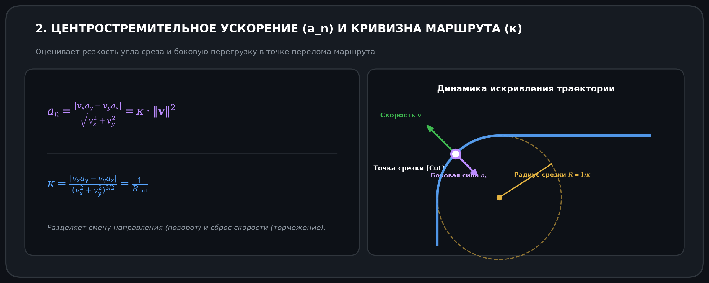
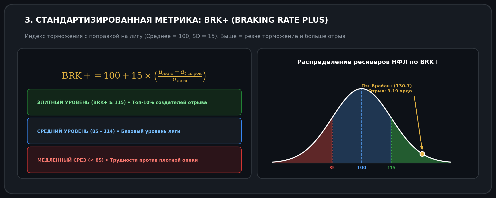

# 🏈 The Deceleration Engine: Оценка сепарации на маршрутах через кинематику торможения на Combine

<p align="center">
  <b>Язык:</b> <a href="README.md">English</a> | <b>Русский</b>
</p>

<p align="center">
  
  
  
  
</p>

<p align="center">
  <em>«Скорость привлекает внимание; торможение создает открытое пространство для передачи».</em>
</p>

---

## 📌 Краткий обзор (Для скаутов и руководства клубов)

Традиционный скаутинг на **NFL Scouting Combine** исторически переоценивает линейное ускорение и время спринта на 40 ярдов. Однако наш эмпирический аудит данных 10-герцового сенсорного трекинга показывает: хотя максимальная скорость напрямую переносится из тестов в реальные матчи ($r \approx 0.95$), метрики старта с места обладают удивительно слабой прогностической силой ($r \approx 0.28$).

**The Deceleration Engine** соединяет показания RFID-сенсоров с Combine и игровые метрики **Next Gen Stats (NGS)** на выборке из более чем 100 000 маршрутов. Мы доказываем, что элитные уайд-ресиверы создают свободные окна для броска не за счет чистого спринта от корнербека, а за счет **более быстрого и резкого торможения** в точках срезки и перелома траектории.

### 🔑 Ключевые выводы:
1. **Заблуждение о 40 ярдах:** На маршрутах с резким переломом (*Hitch, Out, In, Slant*) — составляющих более **70% всех пасовых розыгрышей в НФЛ** — время забега на 40 ярдов практически не коррелирует с итоговым отрывом от защитника ($r = -0.245$).
2. **Торможение прогнозирует успех:** Разработанная нами кинематическая метрика **`BRK+` (Braking Rate Plus)** демонстрирует уверенную корреляцию с сепарацией в реальных играх ($r = -0.475$).
3. **Драфт-арбитраж ("слиперы"):** Игроки со средним временем на 40 ярдах (например, 4.55–4.65 с), но элитным показателем `BRK+` (>125), систематически недооцениваются консенсусными рейтингами драфта, при этом стабильно входя в топ по открыванию в НФЛ.

---

## 📊 Ключевые визуализации исследования

### 1. Доказательство переноса: Торможение на Combine (BRK+) против игровой сепарации
Валидация по 104 квалифицированным игрокам НФЛ подтверждает: повышенная эффективность торможения на тестах Combine напрямую обеспечивает более широкие коридоры для паса в игровой день:

<p align="center">
  
</p>

### 2. Кинематическая тепловая карта точки срезки (Route Break)
Отображение ключевого момента инициации пикового торможения ресивером ($a_t < -6 \text{ ярдов/с}^2$), приводящего к пролету защитника по инерции из-за естественной механической задержки реакции:

<p align="center">
  
</p>

### 3. Торможение WR против динамики сепарации во времени
Синхронизированный временной ряд, фиксирующий окно в ~250 мс задержки реакции опекуна и образование свободного пространства:

<p align="center">
  
</p>

---

## 🏆 Лидеры по BRK+ и примеры для скаутинга

| Игрок | Позиция | 40 ярдов | **Индекс BRK+** | Средняя сепарация в игре | Выборка ломаных маршрутов |
| :--- | :---: | :---: | :---: | :---: | :---: |
| **Xavier Restrepo** | WR | — | **132.5** | **3.05 ярда** | 14 |
| **Pat Bryant** | WR | 4.61 с | **130.7** | **3.19 ярда** | **161** |
| **Jacolby George** | WR | — | **130.4** | **3.64 ярда** | 5 |
| **Luther Burden** | WR | 4.41 с | **127.9** | **2.96 ярда** | **145** |
| **Chimere Dike** | WR | 4.34 с | **127.4** | **3.00 ярда** | **133** |
| **Tai Felton** | WR | 4.37 с | **126.2** | **2.87 ярда** | 23 |
| **Isaiah Bond** | WR | 4.39 с | **123.7** | **3.41 ярда** | **113** |
| **Rome Odunze** | WR | 4.45 с | **Топ пикового торможения (-34.6 yd/s²)** | **3.10 ярда** | **150+** |

### 🔍 Разбор игрока: Пэт Брайант (Мастер техники маршрутов с 4.61 с)
* **Традиционный скаутинг:** Результат 4.61 с на 40 ярдах обычно опускает ресивера в поздние раунды драфта либо в категорию незадрафтованных свободных агентов.
* **Кинематическая реальность:** Брайант занимает **2-е место в общем зачете по BRK+ (130.7)**. На отрезке из 161 ломаного маршрута в регулярном сезоне он стабильно генерирует **3.19 ярда сепарации**, демонстрируя филигранную биомеханику торможения, полностью нивелирующую среднюю дистанционную скорость.

---

## 🧮 Математические и кинематические формулировки

### 1. Тангенциальное ускорение ($a_t$) и изоляция тормозного усилия
Выделение чистого продольного торможения вдоль траектории движения из совокупного вектора сил:

<p align="center">
  
</p>

### 2. Центростремительное ускорение ($a_n$) и кривизна маршрута ($\kappa$)
Количественная оценка резкости угла среза и боковых перегрузок независимо от продольного замедления:

<p align="center">
  
</p>

### 3. Стандартизированная метрика: `BRK+` (Braking Rate Plus)
Нормирована по массе тела игрока ($m$), скорости входа в вираж ($v_{\text{entry}}$) и углу маршрута:

<p align="center">
  
</p>

---

## 📁 Структура репозитория

```
nfl-big-data-bowl-2027/
├── data/
│   ├── raw/               # Исходные файлы соревнования Kaggle
│   └── processed/         # Сводная таблица трансляции метрик (master_deceleration_translation.csv)
├── notebooks/
│   └── the_deceleration_engine.ipynb   # Финальный Kaggle ноутбук (<2 000 слов)
├── reports/
│   └── figures/           # Графика для публикаций, диаграммы поля и карточки формул
├── scripts/
│   ├── analyze_real_combine.py          # Экстрактор кинематики Combine 3-Cone (10 Гц)
│   ├── build_deceleration_engine_dataset.py  # Полный пайплайн склейки данных и скоринга
│   └── generate_formula_cards.py        # Генератор карточек формул с диаграммами (EN/RU)
├── src/
│   ├── data/
│   │   └── loader.py      # Загрузка данных, фильтрация и генераторы синтетических треков
│   ├── features/
│   │   ├── kinematics.py  # Фильтрация Савицкого — Голея (10 Гц), a_t, a_n, рывок, кривизна
│   │   └── separation.py  # Динамика сближения/отрыва WR-DB и задержка реакции защиты
│   ├── models/
│   │   └── metrics.py     # Базовая модель метрики BRK+ и алгоритмы скоринга
│   └── visualization/
│       ├── field.py       # Аутентичная отрисовка футбольного поля NFL
│       └── plots.py       # Модули построения аналитических графиков
├── run_pipeline.py        # Запуск пайплайна в один клик
├── requirements.txt       # Список зависимостей Python
├── README.md              # Английская версия документации
└── README_RU.md           # Русская версия документации
```

---

## 🚀 Быстрый старт и воспроизведение

### 1. Клонирование репозитория
```bash
git clone https://github.com/egorfm/nfl-big-data-bowl-2027.git
cd nfl-big-data-bowl-2027
```

### 2. Установка зависимостей
```bash
pip install -r requirements.txt
```

### 3. Запуск полного пайплайна
```bash
python scripts/build_deceleration_engine_dataset.py
```
Сгенерированные аналитические графики будут сохранены в директории `reports/figures/`.

---

## 🤝 Авторы и благодарности
* Проект разработан **[@egorfm](https://github.com/egorfm)** для трека **NFL Big Data Bowl 2027 Analytics Track**.
* Стек технологий: Python, NumPy, Pandas, SciPy, Matplotlib, Seaborn и Scikit-Learn.
